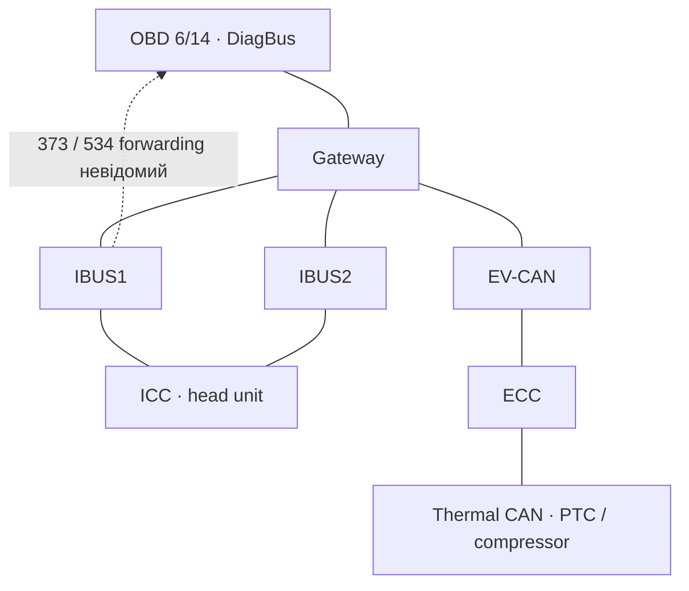

# Fisker Warm — доступність IBUS1 через OBD, етап 7.6

20.10.2026. Fisker Ocean 2023 EU, Ocean OS 2.1, PKC 21.3; S24 Ultra / Android 16; Vgate з BLE-іменем FD-IOS та відповіддю `ELM327 v2.2`.

## 1. Технічний вердикт і рішення

**Прозорий доступ до IBUS1 через стандартний OBD не підтверджено. Нове документальне свідчення підтримує окремий діагностичний сегмент Gateway:** у публічній OEM-маркованій схемі FM29 MY2023 OBD 6/14 з'єднані з DiagBus GW, а IBUS1/IBUS2 мають окремі підключення [S2, аркуші III.10 і VII.5]. Це суттєво сильніший доказ топології, ніж збіг номера 0E9 із DBC. Відповідність цієї редакції конкретному VIN фізично не перевірена.

Власний завершений контроль підтверджує **приймання рядків 0E9 до й після та відсутність рядків 373 у двох 3-секундних OBD-вікнах** [S1]. Він не встановлює точного правила GW forwarding, відсутності ACK, правильності DBC для встановлених ECU або недоступності всієї кліматичної мережі.

**Рішення для проєкту:** припинити повторні пошуки тих самих HVAC broadcast ID через незмінний OBD-шлях. Пріоритет наступного етапу — підтверджений штатний сервісний доступ до **внутрішньої IBUS1** і один пасивний запис там, із перевіркою застосовності схеми та інтерфейсу до підключення. Vgate залишити придатним наявним засобом для вже підтвердженого діагностичного маршруту; причин купувати інший адаптер на той самий OBD зараз немає. Керування HVAC залишається заблокованим. **Реальний запуск клімату не реалізовано.**

## 2. Що реально виміряно у новому файлі

Основне джерело — `Fisker-Warm-HVAC-2026-10-20T08-24-08.778060Z.json`, **171762 bytes**, SHA-256 `3add07e50f00ff607b7a17727028fe825d8e957971fd63e144c435be243ab757`. У файлі **один** CAN_RX_CONTROL 0.3.6, 08:23:38.405397–08:23:49.813414 UTC, тобто 11:23:38–11:23:49 за Києвом. Історичні 0.3.4/0.3.5 captures сюди не домішувалися.

Незалежний [офлайн-аудитор](../scripts/audit_can_topology_stage7_6.py) розбирає CR/LF та ID/DLC/bytes без Android CAN-парсера; звіряє їх із frames[], notifications та глобальним raw BLE-журналом. [Повний результат](../verification/stage7-6/measured-session-analysis.json), [точні raw packets чотирьох фаз](../verification/stage7-6/measured-phase-rx-fixture.json).

| Фаза | Фільтр | Повних рядків / packets / bytes | До stop decision / разом із drain | Достовірний результат |
|---|---|---:|---:|---|
| CONTROL_BEFORE, 0E9 | CM7FF / CF0E9 | 40 / 7 / 1306 | 49 / 150 мс | 40 однакових payload; BUFFER FULL, 2 пошкоджені рядки; capture неповний |
| ECC_VISIBILITY, 373 | CM7FF / CF373 | 0 / 1 / 10 | 3000 / 3048 мс | WINDOW_ELAPSED, host capture повний, overflow немає |
| ECC_ALTERNATE_FILTER, 373 | CRA373 | 0 / 1 / 10 | 3000 / 3048 мс | WINDOW_ELAPSED, host capture повний, overflow немає |
| CONTROL_AFTER, 0E9 | CM7FF / CF0E9 | 41 / 7 / 1292 | 59 / 153 мс | 41 однаковий payload; BUFFER FULL, 1 пошкоджений рядок; capture неповний |

У кожному вікні 373 є тільки `STOPPED\r\r>` після SPACE. Жодних CAN bytes для відкидання парсером там немає. Обидва контролі незалежно перераховані як 40/41; їхні payload різні між фазами (`2DF0FFFF9E57FFFF` та `8FF3FFFF00009EF2`), але однакові всередині кожного burst. Це не дає 81 незалежного фізичного CAN timestamp і не підтверджує семантику BMS для власника.

Усі **46 TX_REQUEST** — фіксовані AT-команди адаптера або SPACE; кожен має один успішний GATT callback і completion. ATMA виконано чотири рази, відновлення після першого overflow — один раз. Перед 373 повторно підтверджені startup, CSM1 і DPN=6; для альтернативи справді виконані ATAR → ATCRA373 → ATMA. Немає запитів UDS або CAN payload від застосунку. Повний bleIo збережений, droppedEvents=0; це не незалежний вимір усіх втрат усередині CAN/Vgate/BLE.

`differentialPhasesCompleted=true`, обидва controlRxObserved=true, eccCapturesComplete=true. Одночасно root.incomplete=true та allCapturesComplete=false через втрати контролів. Така класифікація правильна; `eccCapturesComplete` описує штатне завершення host-вікон, а не гарантовану доставку кожного фізичного кадру.

**0x534 у цьому сеансі не вимірювався.** Його попередній нульовий результат при HMI-діях у 0.3.4 залишається історичним свідченням із межами етапу [7.4](CAN-RX-AUDIT-STAGE7-4-UA.md). Новий sandwich-контроль 373 не створює заднім числом такого ж контролю для 534. У новому файлі ownerMarks порожній, climateRunning/gear/speed — null; фізичний стан HVAC у ці шість секунд не записаний незалежним каналом. Старі HMI_ON/AIRFLOW_PRESENT не переносяться в новий сеанс.

## 3. Нові первинні документи та їхні межі

Знайдені публічні прямі посилання спільноти на два різні документи [S2–S3]. PDF завантажені без входу/обходу авторизації, прочитані текстово; ключові провідники перевірені на зображеннях сторінок. Вони **не були отримані з офіційного VIN-порталу**: це OEM-марковані копії на Google Drive. Оригінали, їхні повні тексти й зображення не перепубліковані в репозиторії. [Реєстр джерел, hashes та сторінок](../verification/stage7-6/source-ledger.json).

| Документ | Редакція / ідентичність | Як використано | Чого не підтверджує |
|---|---|---|---|
| **FM29 MY2023 SORP Wiring Diagrams** [S2] | 91 PDF-сторінка; ключові drawings rev 1; PDF metadata creation 27.03.2023; SHA-256 `bd9d4731622b18060ba041a7d6c6c029e89dc7b7a9d58a50b924e03c3ca927f7` | Основний документальний опис проводки. Є LHD/RHD та ALL позначення. PDF p.13/29 — діагностика/GW; p.9/69 — ICC; p.4/5/67 — ECC | Metadata не є датою OEM release. Немає VIN-effectivity або підтвердження OS 2.1. На IBUS-аркуші p.9 заголовок SORP, а status block PP: комплект має неоднорідні стадії випуску |
| **Magna FM29 PT Full System Schematics** [S3] | 144 сторінки; **V0.04, 01.02.2022**; SHA-256 `de13684830b87d1f4ce0a8655aded4f42122d9ff4622a94ea3cbfcfe496f1086` | Додаткова архітектура, історія змін, перевірка суперечностей | Це ранній логічний комплект; він сам застерігає про символічне розміщення. Не готова монтажна схема серійного авто |

**Суперечність редакцій:** у S3 p.12/23/40 зазначено перенесення DLC1 із Diagnostic CAN на TBus; p.12 містить CAN-FD 2 Mbps. Натомість S2 p.13/29 явно показує окремі GW DiagBus pins і OBD. Зводити ці редакції в одну «підтверджену схему» або на підставі S3 перемикати Vgate на CAN-FD не можна. Для цього звіту фізичні зв'язки взяті з S2, а конфлікт із S3 залишається відкритим до VIN-відповідної документації. Зміна PDF modification metadata S3 у 2023 році не перетворює його титульну редакцію 2022 року на production as-built.

Отже, схему для **MY2023** знайдено; схему, офіційно атестовану саме для **EU VIN / поточних ECU власника**, не отримано. OS на екрані не є номером ревізії джгута або таблиці маршрутизації GW.

## 4. Фізична архітектура і логічні маршрути

На схемі нижче суцільні зв'язки — **провідники за MY2023 S2**, а не вимірювання на автомобілі. Пунктир — невідоме пересилання конкретних CAN ID. Екран CID і контролер ICC відрізняються; тут ICC позначає head unit.



| Компонент / сегмент | Документальне підключення | Джерело / достовірність | EU MY2023 / OS 2.1 власника |
|---|---|---|---|
| OBD | V342B*1F X*06/X*14 → GW C001B*1F A*30/A*14; DiagBus H/L, W1040_1/2 | S2 p.13, III.10; повторно p.29, VII.5; **показано провідниками** | Є ALL та LHD/RHD; VIN і OS не атестовані |
| IBUS1 | Окрема пара GW A*09/A*25; ICC A*A9/A*A16 | S2 p.9, III.6; p.69, XVIII.1; **документально** | Та сама межа застосовності |
| IBUS2 | Окрема пара GW A*05/A*21; ICC A*A17/A*A24 | Ті самі аркуші; **документально** | Та сама межа |
| ECC | EV-CAN; інша пара — власна Thermal CAN до компресора/PTC | S2 p.4/5/67, III.1/III.2/XVII.2; **документально** | VIN/ECU effectivity не доведена |
| TBOX | Окремий Telematics CAN до GW; не IBUS1 | S2 p.11, III.8; **документально** | Версія штатного віддаленого протоколу невідома |
| Інші CAN | GW також має Body, Chassis, Brake, ADAS, Inverter ports; окремі Thermal, battery/charging підмережі показані у відповідних drawings | S2 p.4–12/29; **документальні сегменти**, не виміряний census | Не розгортаємо до вгаданої повної as-built конфігурації |

Важливе уточнення: **кліматичні сигнали на IBUS1 не означають, що сам ECC фізично сидить на IBUS1.** S2 показує ECC на EV-CAN, а S4 називає передавачем ECC-статусу на IBUS1 GW. Разом це узгоджується з віддзеркаленням статусу між сегментами. Точне перетворення кадрів, напрямок дозволів та правило для команди ICC → ECC ще не відновлені.

**Інші контакти та інший роз'єм.** У S2 p.9 внутрішній development connector `V078B*1F` / `HDP24-24-31SE-L017` має відгалуження IBUS1/2; стандартний OBD на p.13 — інший `V342B*1F` / `348822-2`. Номери контактів Spider Port у документації Pulse [S7] не є номерами альтернативних мереж стандартного OBD. Для OBD 3/11 чи інших manufacturer-specific pins підтвердженого маршруту до IBUS1 у використаних джерелах немає. **Це опис документів, не інструкція переставляти контакти, під'єднувати Vgate до V078 або розбирати авто.**

## 5. Аудит DBC: походження, ID та значуща втрата метаданих

Pinned S4: `moistpope/oceanfront-view`, commit `68a88af90b369c1b2c55d7949c4c848f41deb857`; 20.10.2026 це все ще актуальний HEAD. DBC SHA-256 `0cbf35b8f65e8f1184b4c0c9db4fc9877c33382b8d744cf717a69f3ff622912b`. Історія цього файла містить публікацію 04.10.2026 та зміну 05.10.2026; свіжість Git-коміту не змінює вік вихідної матриці. [Перевірена provenance](../verification/stage7-6/upstream-provenance.json).

У VERSION і генераторі S5 названо дві окремі **FM29 IBUS1/IBUS2 V390.1 від 20.01.2023**. Оригінальних XLSX у публічному дереві немає; OEM походження й застосовність до прошивок власника незалежно не атестовані. **V390.1 — ревізія матриці, а не доведений еквівалент Ocean OS 2.1 чи ICC390C49.**

| ID | Назва / значення за похідною матрицею | Шина; заявлений sender | Період | Точне місце S4 | Статус на власному авто |
|---|---|---|---|---|---|
| 0x373 | ECC status: ECC_CrtSts, ECC_WindSpdSts, ECC_HeatSts, ECC_RemSts | IBUS1; **GW** | cyclic **100 мс** | [BO/signals 759–783][D373]; [comment 3695][C373]; [cycle 5691][P373] | Не спостерігався в новому OBD-контролі; внутрішня IBUS1 не виміряна |
| 0x534 | ICC_ECCSysSwtCmd, HMI On/Off кандидат | IBUS1; **ICC** | NoMsgSendType; cycle не заданий, default 0 | [BO/signals 1244–1255][D534]; [comment 4107][C534] | Історичний OBD-нуль; у новому сеансі не тестувався; виконання команди не підтверджене |
| 0x0E9 | BMS_ActualPack_U_I у DBC | IBUS2; **GW** | cyclic **20 мс** | [BO/signals 1496–1500][DE9]; [comment 4317][CE9]; [cycle 5753][PE9] | Числовий ID і payload отримані. Походження саме з BMS/IBUS2 та номінальний період на OBD не доведені |

**Чи повинен 373 повторюватися без змін клімату?** За цією матрицею — так, у стані, де циклічне повідомлення активне: 100 мс означає повторення, а не лише зміну HMI. За підтверджених тих самих умов на відповідному сегменті 3 секунди дали б близько 30 періодів. Але матриця не встановлює active/sleep умови та OBD forwarding власника. Тому пояснення «просто не перемикали клімат» не достатнє для сумісного активного IBUS1, а нуль OBD не спростовує саму внутрішню матрицю. Для 534 регулярний heartbeat не заявлений; тривале очікування без події не є сильним тестом.

**Нове обмеження генератора, важливе для архітектури** [S5, read_matrix/write_dbc]:

- [Рядки 141–162][GREAD] читають sender-колонки `s`; receiver-матриця не переноситься як повний routing contract.
- [Рядок 221][GRECV] дописує `ICC` одержувачем **кожного** SG_. Тому SG_ receiver=ICC — згенерований placeholder, а не підтвердження всіх OEM одержувачів. Особливо не можна вивести з нього фізичний маршрут 534 до ECC.
- [Рядки 187–190][GTX] допускають fallback sender=GW та окрему авторську нормалізацію ADAS. Для наших трьох ID додатково є явний sender у CM_ BO_, але це все одно похідний опис.
- [Рядки 204–209][GMERGE] прибирають повторний числовий ID після об'єднання IBUS1/2. Повна багатошинна ідентичність та routing rule з такого DBC не відновлюються.

Оригінальні умови передачі, усі receiver-колонки, правила gateway та VIN/software effectivity потрібно перевіряти у вихідних матрицях/специфікації. [Машиночитаний аудит](../verification/stage7-6/dbc-provenance-audit.json) зберігає ці невідомі явно. Публічне дерево S4 не містить вихідних XLSX або автомобільної raw CAN-траси для незалежної перевірки зазначених режимів. Наявність у автора приватних вимірювань цим не заперечується.

## 6. Що це означає для Gateway та причин нульового RX

Окремі фізичні CAN ports самі по собі не об'єднують broadcast домени. Для появи внутрішнього кадру на DiagBus потрібен налаштований маршрут/перепублікація GW. **Такий маршрут саме для 373/534 у відкритих матеріалах не встановлений.** Історичні відповіді ECC `7F0/7F8` та F195 у [технічному звіті](TECHNICAL-REPORT-UA.md) підтверджують діагностичний request/response маршрут у момент тих читань; вони не описують таблиці пересилання широкомовних повідомлень.

0E9 може бути видимим, коли 373/534 не видимі: достатні вибіркова публікація одного ID, інша конфігурація сигналів або особливість передачі на діагностичному сегменті. **Який саме механізм працює тут — невідомо.** 0E9 не доводить прямого фізичного OBD=IBUS2, а його назва BMS у чужому DBC не атестує джерело отриманих bytes.

| Причина / гіпотеза | Докази за | Що проти або чого бракує | Оцінка |
|---|---|---|---|
| **Окремий DiagBus, немає потрібної broadcast-маршрутизації** | Конкретна MY2023 проводка S2; 373=GW mirror на IBUS1; нуль у двох exact API при наявному контролі | Немає актуальної routing table GW та as-built перевірки VIN; окремий порт не доводить заборони конкретного ID | **Найсильніше архітектурне пояснення**, не доведений список заблокованих ID |
| **Повтори без ACK / робота одиночного GW на DiagBus** | S2 показує GW↔OBD окремо; усередині кожного контролю однакові bytes, а номінальні 20 мс не відповідають host burst; стандартний CSM1 не генерує ACK [S9]; незалежний експеримент S10 дає повтори за таких умов | Silent mode Vgate фізично не атестований, ACK/error/wire timestamps відсутні, поведінка TX-черги GW невідома; кеш/повтор Vgate не виключений | **Предметна конкуруюча гіпотеза.** Якщо невизнаний кадр утримує TX-чергу, нулі інших ID не вимірюють routing policy. Не встановлений діагноз |
| **Невідповідність матриці або стану ECU** | Матриця 2023, похідна/втратна; немає відповідності OS/VIN; новий HVAC state не записаний | Є source-level реалізація IBUS1 та узгоджена документальна архітектура; внутрішня траса власника відсутня | **Реальна альтернатива**, перевіряється на внутрішньому маршруті |
| **Особливість Vgate exact filters / firmware** | ATI не дає фактичної vendor firmware; CM/CF і CRA можуть викликати той самий внутрішній фільтр | Маска 7FF правильна для рівності 11 біт; порядок/start/stop простежені; правильний E9 є до/після; для 373 взагалі немає CAN-text RX | Не виключено без незалежного reference; **не підстава оголосити адаптер несправним** |
| **Android парсер/зупинка не дозволили побачити 373** | Це було важливо до виправлення 7.5 | Тепер обидва вікна виконані; raw містить тільки STOPPED/prompt, усі MA/stop completions є, host drops не зареєстровані | **Поточний журнал не підтримує цю причину**; фізичні upstream втрати все ще невиміряні |
| **Потрібен 29-bit / інша швидкість / CAN-FD** | Старий S3 згадує іншу архітектуру; реальний frame format цільового сигналу не виміряний | S4 задає стандартні ID, 8 bytes; S6 використовує окремі classic MCP251x для IBUS; SP6 дає контрольний потік | Для цих кандидатів **немає нової доказової підстави** сканувати інші протоколи |

CSM1 відповідає пасивній меті, але `OK` не перевіряє фізичний ACK. На point-to-point CAN із єдиним передавачем та silent receiver приймання може бути спотворене повторними спробами передавача [S9–S10]. Саме тому позитивний контроль не сертифікує прозорість усіх ID. **CSM0, додавання ACK-вузла, новий BUFFER FULL експеримент або ATCS після reset не обрані:** поточні обмеження їх не дозволяють або збережені після reset лічильники не відновлюють минулу фізичну подію. Причину ACK не можна оголосити доведеною за самими однаковими payload.

Залежність forwarding від KL15, sleep, diagnostic session чи security state залишається невідомою. Документованої процедури «відкрити IBUS1 monitor через OBD» не знайдено. `10 03` або довільні session/routing control запити не дають дозволеного тут рішення та не виконувалися.

## 7. Оцінка Vgate та чинної програми

Офіційна сторінка FD+ [S8] описує AT/ST, ISO 15765-4, raw CAN та MS-CAN; FD-IOS є назвою BLE-інтерфейсу в інструкції цієї сім'ї. Це не підтверджує точну ревізію власного dongle. Маркетингові літери **FD не є атестацією CAN-FD**, а MS-CAN не створює доступ до не під'єднаних проводів.

На власному пристрої підтверджений UART service 18F0, RX 2AF0 / TX 2AF1, проходження startup та чотирьох MA/stop циклів із отриманням E9. Формат кандидатів у S4 сумісний із поточним 11-bit/8-byte декодуванням. Їхній фактичний wire format на власнику та незалежна перевірка фільтра для 373 залишаються невідомими. S8 не є таблицею GW forwarding Fisker.

ATCM/CF/CRA змінюють приймальну селекцію **наявного фізичного каналу**. Вони не переводять OBD DiagBus на IBUS1. `ATCAF0` і `ATCFC0` не створюють diagnostic subscription, а ATMA не встановлює маршрути GW. Звірені raw TX/RX та чинний [CanRxAudit](../app/src/main/java/com/fiskerwarm/lab/core/CanRxAudit.java) не дають конкретного Android-дефекту, який треба виправляти новим APK.

**Висновок щодо обладнання:** Vgate здатний передавати адаптерні налаштування й отримувати CAN-текст на поточному OBD. Його придатність як достовірного пасивного логера всіх потрібних IBUS-повідомлень не доведена; основна нова перешкода — підтверджений документами поділ фізичних сегментів і невідомий forwarding. Заміна dongle на тому самому порту сама по собі не усуває цієї залежності. Потреба у новому фізичному інтерфейсі визначається лише після вибору та підтвердження внутрішнього доступу.

## 8. Порівняння технічних шляхів

| Варіант | Здійсненність і потрібний доказ | Обмеження / ризик | Витрати, складність | Рішення |
|---|---|---|---|---|
| **1. Поточний OBD + Vgate, HVAC broadcast** | RX E9 є; потрібна реальна GW mapping/trace, що 373/534 надходять на DiagBus у дозволеному режимі | Повторний нуль не відрізнить routing, ACK, firmware та DBC. Тривале підключення утримує 12 V навантаження | Наявне обладнання, додаткові покупки 0; нової продуктивної перевірки цим самим способом немає | **Відкласти повторні HVAC сканування.** Не відхиляти OBD як діагностичний інтерфейс |
| **2. Read-only діагностика через GW** | Identity ECC реально читалася; потрібен документований live HVAC status DID, його версія, сесія й semantics | Читання UDS передає запит автомобілю; тут не виконувалося. Identity не дорівнює HVAC ON, стан компонентів не гарантує командного контракту | Vgate/Android можуть бути достатні для документованого request/response; нова апаратна покупка не обґрунтована, R&D невідоме | **Продовжувати лише офлайн за новою специфікацією.** Наразі live DID та штатний UDS CLIMATE ON не встановлені |
| **3. Інший штатний цифровий інтерфейс** | PKC-шлях потребує чинної owner authorization; ICC source-кандидат є, але штатний зовнішній API не підтверджений. O Loop заявляє preconditioning [S11] | З етапів 7/7.1 збережені обмеження VA/SDK. O Loop прямо відключив legacy third-party API; немає дозволеного незалежного Warm API та атестації OS 2.1 | Поточна ціна O Loop на офіційній сторінці — $499/рік плюс податки; це окремий сервіс, не рекомендована залежність проєкту. Нові передплати не обираються | **Відкласти незалежну інтеграцію** до доступного підтримуваного контракту; старий PKC/AOT аналіз і листування не повторювалися |
| **4. Пасивний доступ до внутрішньої IBUS1** | S2 дає конкретний окремий service/development connector; S6 має окремі can1/can2; S7 підтверджує багатошинний фізичний підхід. Потрібні VIN-fit, перевірений пасивний інтерфейс/кабель та raw trace | Невірний контакт, полярність, termination, живлення чи непасивний transceiver можуть завадити шині. Потрібен підготовлений сервісний доступ; власнику не пропонується втручатися в джгут | Можна використати вже наявне сервісне обладнання; конкретної пропозиції/вартості немає. Складність вища за OBD, але доступ напряму усуває залежність від DiagBus forwarding. Нічого не купувати до підтвердження | **Пріоритетний наступний напрям** перевірки CAN-кандидата; ще не спосіб дистанційного HVAC ON |

Відкритий S6 справді читає окремі IBUS1/IBUS2 контролери та має source-level кліматичний TX. Це доводить відмінність його доступу від Vgate/OBD, але не документує safe start/stop, sleep/wake, авторизацію та виконання на власному авто. Повний 534 також містить інші налаштування. Його не можна просто передати після одного позитивного RX. Шлях ICC → GW → ECC на рівні повідомлень і життєвий цикл штатного preconditioning потребуватимуть окремої наступної верифікації.

## 9. Чи потрібен новий автомобільний тест зараз

**Повторний OBD-тест не обрано.** Старі 30-секундні 373/534, sandwich 0E9→373→0E9, подовження вікон, broad MA, інший exact filter або CSM0 не усувають ключову нову невідомість: що є на внутрішній IBUS1 при відповідній прошивці. Нового APK для них не потрібно.

Найкоротша пріоритетна дія — **підготувати один сервісний пасивний запис внутрішньої IBUS1 за підтвердженою штатною схемою**, а не ще один сеанс на DiagBus. Це визначає наступний етап, а не дозвіл підключати неперевірений перехідник сьогодні.

Перед таким записом потрібні конкретні передумови: сервіс підтверджує VIN-відповідність роз'єму/джгута з S2, обидва CAN провідники, штатну termination, сумісність та фізичне TX-disable/silent поведінку вже наявного інтерфейсу; власник погоджує саме цю підготовлену процедуру. Немає доручення розбирати авто, переставляти OBD pins, купувати Pulse або інший пристрій. Авторизовані активні автомобільні команди у цьому плані **відсутні**.

| Питання до майбутнього вимірювання | Конкретна відповідь / критерій |
|---|---|
| Яку невідомість усуває? | Чи існують 373/534 саме на внутрішній IBUS1 цієї конфігурації. Це розділяє внутрішню матрицю/стан ECU та обмеження поточного OBD-шляху |
| Чому наявні журнали недостатні? | Вони отримані тільки через OBD DiagBus; не вимірюють IBUS1, ACK або gateway queue |
| Чи можна без автомобіля? | Так, якби була достовірна існуюча raw IBUS1-траса з версіями ECU та діями. У переглянутому публічному дереві її немає; схема сама не перевіряє живі ID |
| Мінімальний зміст одного майбутнього сеансу | Валідація реально активної IBUS1 незалежними RX/error counters; короткий лог із hardware timestamps та точними 373/534 filters. Один штатний HMI On/Off із часовими позначками. Жодного стороннього payload, diagnostic session, ECU reset чи примусового wake |
| Позитивний результат | Повні 373 та/або 534 на внутрішньому інтерфейсі; 534 корелює з HMI, статуси 373 — із фактичним кліматом. Підтверджено доступ/кандидат матриці; причина відсутності на DiagBus може залишитися неоднозначною |
| Негативний результат | За незалежно підтвердженої активної IBUS1, справного приймача й штатного HVAC нуль 373 послабить застосовність цього ID/DBC. Якщо фізичний маршрут/активність не підтверджені, нуль неінтерпретований; повторювати не треба |
| Ризик і припинення | Неправильний роз'єм/termination або небажаний TX, пробуджене авто й 12 V. Працює підготовлений фахівець; при помилках шини/попередженнях штатно зупинити запис, від'єднати сервісний інтерфейс, повернути штатний HMI стан. Без програмних reset/clear; кліматичною системою керує лише власник штатним екраном |

Таке вимірювання не має повторювати старий OBD-HMI експеримент: **змінюється документально обраний фізичний сегмент і використовується перевірений приймач**. Без цих двох змін новий тест не пропонується. Навіть позитивний результат не дозволяє передачу 534 або довільних команд ECC.

## 10. Невідомі та необхідні докази

| Невідоме | Що саме закриє питання |
|---|---|
| As-built OBD/GW/IBUS для EU VIN | OEM wiring effectivity/джгутова ревізія або документоване сервісне підтвердження застосовності S2; не CAN ID |
| Пересилання 373/534 на DiagBus і залежність від KL15/sleep | Актуальна GW routing specification або синхронна довірена внутрішня/діагностична траса. Відкриття session не є її заміною |
| Чи був burst наслідком відсутності ACK | Незалежні wire ACK/error timestamps та атестована поведінка transceiver; з поточного raw BLE не відновлюється |
| Чи приймає Vgate цільовий ID правильно | Контроль на відомому джерелі/стенді або незалежний еталон на тому самому сегменті. `OK` та два API тієї самої firmware цього не доводять |
| Відповідність 373/534 актуальним ECC/ICC/GW | Вихідні матриці з software effectivity або пасивна внутрішня траса цієї конфігурації. Ідентичний номер OS сам по собі недостатній |
| Повний route ICC climate request → ECC | OEM signal-routing contract, повний штатний payload та його приймання/стани; receiver ICC у згенерованому DBC не підходить |
| Авторизований CLIMATE ON після сну | Підтримуваний owner interface, wake/enable умови, підтвердження реальної роботи, збережені налаштування та незалежний штатний stop/timeout. Пасивний RX цього не реалізує |

## 11. Перевірена робота й відтворення

Новий офлайн-аудитор пройшов **44 перевірки узгодженості доказів**: raw counts/payload/пакети; чотири фази; фактичні GATT completions; 46 дозволених adapter writes; recovery/filter порядок; збережена неповнота; pinned DBC/generator hashes та їхні обмеження; hashes/page counts і пошукові anchors PDF. [Результат](../verification/stage7-6/offline-evidence-checks.json). PDF text anchors лише знаходять сторінки: провідники ключових drawings перевірені окремо візуально. Це не автоматичне розпізнавання електросхем і не нове автомобільне випробування.

```sh
python3 scripts/audit_can_topology_stage7_6.py \
  --log /path/to/Fisker-Warm-HVAC-2026-10-20T08-24-08.778060Z.json \
  --source-root /path/to/pinned-oceanfront-view \
  --wiring-pdf /path/to/wiring-diagrams.pdf \
  --architecture-pdf /path/to/system-schematics.pdf \
  --output verification/stage7-6
```

Потрібні Python 3 та Poppler для PDF anchors. Оригінальний owner export не перепубліковується: опубліковані лише вибрані CAN/AT докази без MAC, VIN або секретів. 321 тест попереднього Android runtime з 7.5 не видається за нову перевірку доступності IBUS1. Змін runtime, ReadOnlyPolicy, HeatSafety, підпису/версії та main — **0**. Нових APK, запитів до автомобіля, firmware changes, покупок або звернень до постачальників — **0**.

**Підсумкове рішення:** поточний OBD залишається діагностичним маршрутом із підтвердженим E9 RX, але не доведеним прозорим IBUS1 tap. Подальший CAN-шлях до HVAC має спиратися на окремий підтверджений внутрішній доступ. Наступна ціль — доказ живого кліматичного сигналу на правильному фізичному сегменті; до того кнопка керування автомобілем заблокована.

## Джерела та точні посилання

- **S1:** новий owner JSON за SHA вище; його незалежно перевірені [measurements](../verification/stage7-6/measured-session-analysis.json) та [raw phase fixture](../verification/stage7-6/measured-phase-rx-fixture.json). Факти саме автомобіля власника; hardware timestamps/ACK не записані.
- **S2:** [MY2023 SORP Wiring Diagrams, 91 p.](https://drive.google.com/file/d/1CGwOiLSLDR0w7LPi06dHyWnFvIA2Rkgc/view). Основні PDF pages: 13 / drawing III.10; 29 / VII.5; 9 / III.6; 69 / XVIII.1; 4 / III.1; 5 / III.2; 67 / XVII.2. [Публічна сторінка походження посилань, 30.10.2024](https://www.fisker-ocean-forum.de/forum/thread/494-linkliste-zu-fahrzeugdokumenten-wartung/). Документ OEM-маркований, community-hosted, не VIN-атестований.
- **S3:** [Magna System Schematics, 144 p.](https://drive.google.com/file/d/1APFvIw_MYfNeS-SB48eA_QE9CV49huH4/view), title p.1, network p.12, GW p.23/40; дата титулу 01.02.2022. [Історичне повідомлення про поширення обох документів, 21.08.2024](https://www.fisker-ocean-forum.de/forum/thread/432-verkabelungsdiagramme-logischer-elektronischer-aufbau-des-oceans-von-magna/). Форум використано для discovery, технічні зв'язки — із самих drawings.
- **S4:** [Pinned IBUS DBC](https://github.com/moistpope/oceanfront-view/blob/68a88af90b369c1b2c55d7949c4c848f41deb857/dbc/fisker_ocean_ibus.dbc). Назви й цикли — похідні; сумісність із власником не атестована.
- **S5:** [Генератор IBUS DBC](https://github.com/moistpope/oceanfront-view/blob/68a88af90b369c1b2c55d7949c4c848f41deb857/tools/gen_ibus.py), lines 3–22, 141–162, 187–235. [README](https://github.com/moistpope/oceanfront-view/blob/68a88af90b369c1b2c55d7949c4c848f41deb857/README.md), [перший commit live IBUS controls](https://github.com/moistpope/oceanfront-view/commit/2aaa6f568810d5e7ab892036e18ae25f74491b0b). Вихідний код і авторська заява, не незалежний тест нашого авто.
- **S6:** [CanBridge.kt lines 16–36](https://github.com/moistpope/oceanfront-view/blob/68a88af90b369c1b2c55d7949c4c848f41deb857/android/app/src/main/java/ai/sunnypilot/webhud/CanBridge.kt#L16-L36), can1/IBUS1, can2/IBUS2, MCP251x; [SocketCAN helper](https://github.com/moistpope/oceanfront-view/blob/68a88af90b369c1b2c55d7949c4c848f41deb857/android/canbridge/main.go). Не той самий фізичний доступ, що звичайний OBD.
- **S7:** [Pulse, Updates і Tutorials → CAN BUS](https://www.oceanlinkpulse.com/). Первинний опис виробника окремого Spider Port/кількох CAN; не OEM permission виконувати climate TX.
- **S8:** [Vgate FD+ product specification](https://www.vgatemall.com/products-detail/i-23/), Support Protocols та Android/iOS connection names; [офіційний download center](https://www.vgatemall.com/downloadcenter/). Firmware не завантажувалася й не змінювалася. Не використано недоведені сторонні твердження, що назва FD гарантує CAN-FD.
- **S9:** [ELM327DSK v2.2](https://www.elmelectronics.com/wp-content/uploads/2017/01/ELM327DS.pdf), printed pp.14–16 (filters/CRA/CSM), 49 (monitoring). Документація оригінального IC, не фізична атестація Vgate.
- **S10:** [CSS Electronics, CAN errors, Test #4](https://www.csselectronics.com/pages/can-bus-errors-intro-tutorial), власний експеримент виробника з передавачем та silent receiver без ACK. Механізм підтверджений на їхньому стенді; його застосовність до цього Fisker — гіпотеза.
- **S11:** [OV Loop: Features, OS Updates, Pricing, FAQ → third-party tools](https://ocean.ovloop.com/), перевірено 20.10.2026. Заявлені можливості й обмеження свого сервісу, не публічний протокол Warm. Платна послуга не обирається необхідною умовою.
- Використані попередні докази: [7.2](HVAC-WITHOUT-VA-STAGE7-2-UA.md), [7.4](CAN-RX-AUDIT-STAGE7-4-UA.md), [7.5](CAN-RX-BURST-STAGE7-5-UA.md), [7.1](PKC-OWNER-KEY-STAGE7-1-UA.md). Неперевірені AI-статті продавців запчастин, загальні пояснення іншої моделі Fisker і форумні припущення не використані як pinout/routing докази.

[D373]: https://github.com/moistpope/oceanfront-view/blob/68a88af90b369c1b2c55d7949c4c848f41deb857/dbc/fisker_ocean_ibus.dbc#L759-L783
[C373]: https://github.com/moistpope/oceanfront-view/blob/68a88af90b369c1b2c55d7949c4c848f41deb857/dbc/fisker_ocean_ibus.dbc#L3695
[P373]: https://github.com/moistpope/oceanfront-view/blob/68a88af90b369c1b2c55d7949c4c848f41deb857/dbc/fisker_ocean_ibus.dbc#L5691
[D534]: https://github.com/moistpope/oceanfront-view/blob/68a88af90b369c1b2c55d7949c4c848f41deb857/dbc/fisker_ocean_ibus.dbc#L1244-L1255
[C534]: https://github.com/moistpope/oceanfront-view/blob/68a88af90b369c1b2c55d7949c4c848f41deb857/dbc/fisker_ocean_ibus.dbc#L4107
[DE9]: https://github.com/moistpope/oceanfront-view/blob/68a88af90b369c1b2c55d7949c4c848f41deb857/dbc/fisker_ocean_ibus.dbc#L1496-L1500
[CE9]: https://github.com/moistpope/oceanfront-view/blob/68a88af90b369c1b2c55d7949c4c848f41deb857/dbc/fisker_ocean_ibus.dbc#L4317
[PE9]: https://github.com/moistpope/oceanfront-view/blob/68a88af90b369c1b2c55d7949c4c848f41deb857/dbc/fisker_ocean_ibus.dbc#L5753
[GREAD]: https://github.com/moistpope/oceanfront-view/blob/68a88af90b369c1b2c55d7949c4c848f41deb857/tools/gen_ibus.py#L141-L162
[GRECV]: https://github.com/moistpope/oceanfront-view/blob/68a88af90b369c1b2c55d7949c4c848f41deb857/tools/gen_ibus.py#L221
[GTX]: https://github.com/moistpope/oceanfront-view/blob/68a88af90b369c1b2c55d7949c4c848f41deb857/tools/gen_ibus.py#L187-L190
[GMERGE]: https://github.com/moistpope/oceanfront-view/blob/68a88af90b369c1b2c55d7949c4c848f41deb857/tools/gen_ibus.py#L204-L209
